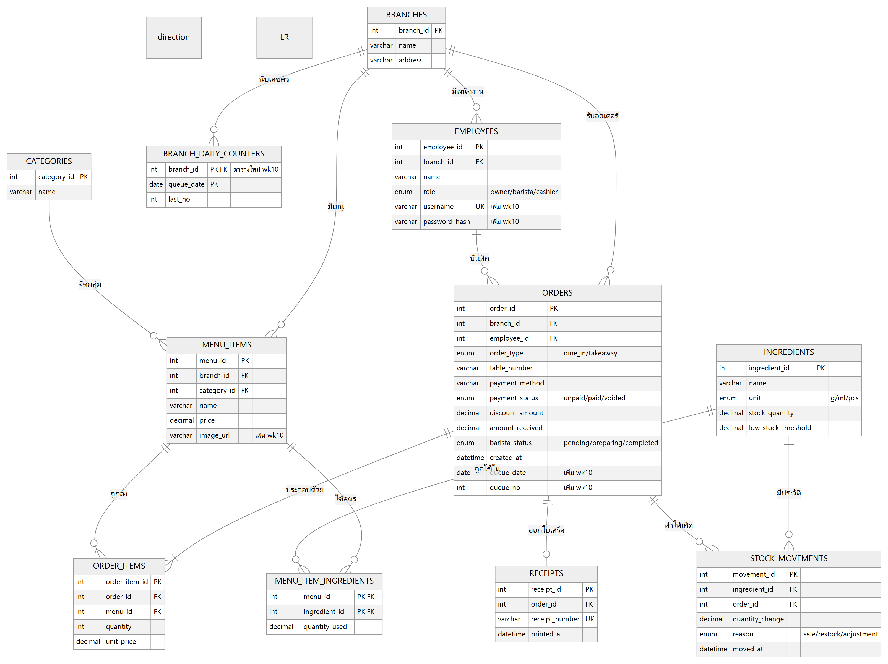
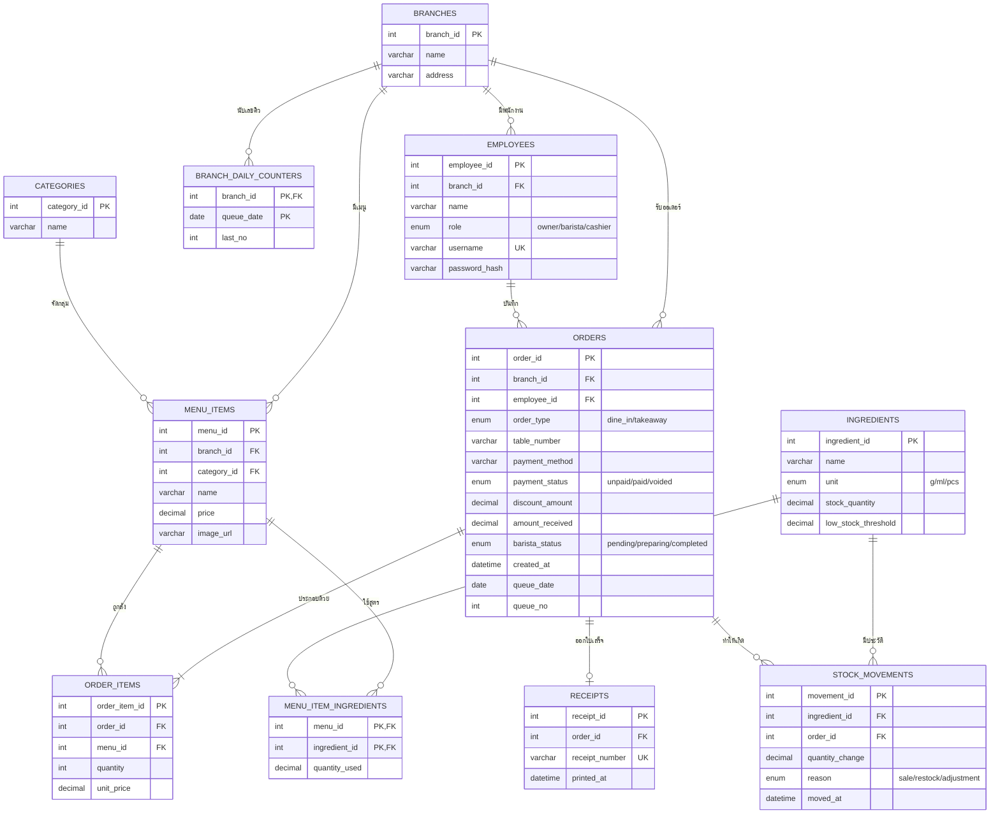

# Week 7 — ER Diagram (ฉบับปรับปรุงให้ตรงกับ schema ล่าสุด)

> ER Diagram ของระบบ Baristech Cafe POS ใช้เป็นต้นแบบของ `schema.sql`
> ตอนนี้มี **11 ตาราง** ตรงกับ `code/schema.sql` ที่ใช้งานจริง

ภาพ ER Diagram:

- ฉบับสัปดาห์ 7 (10 ตาราง, วาดด้วย MySQL Workbench): `images/wk07-er-diagram.png`
- **ฉบับปัจจุบัน (11 ตาราง)**: `images/wk07-er-diagram-final.png`

## สิ่งที่เพิ่มหลังสัปดาห์ 7 (ทำในสัปดาห์ 9–10)

| ส่วนที่เพิ่ม | ตาราง | เหตุผล |
|---|---|---|
| คอลัมน์ `image_url` | `menu_items` | แสดงรูปสินค้าบนหน้า POS |
| คอลัมน์ `username`, `password_hash` และค่า role `owner` | `employees` | ระบบล็อกอินและแยกสิทธิ์เจ้าของ/แคชเชียร์ |
| คอลัมน์ `queue_date`, `queue_no` (ไม่ซ้ำต่อสาขาต่อวัน) | `orders` | เลขคิวรายวัน A001, A002, ... |
| ตารางใหม่ `branch_daily_counters` | — | เก็บเลขคิวล่าสุดของแต่ละสาขาในแต่ละวัน |
| ค่า `voided` ใน `payment_status` และคอลัมน์ `branch_id` ใน `menu_items` (สัปดาห์ 9) | `orders`, `menu_items` | ยกเลิกบิลแบบไม่ลบข้อมูล และกันการเข้าถึงเมนูข้ามสาขา |

## Mermaid

หมายเหตุ: ยอดรวม ยอดสุทธิ และเงินทอนของออเดอร์ **ไม่เก็บในตาราง** `orders` (เป็นค่าที่คำนวณได้ จึงคำนวณสดจาก `order_items` เพื่อกันข้อมูลไม่ตรงกัน ตามหลัก Normalization 3NF)
